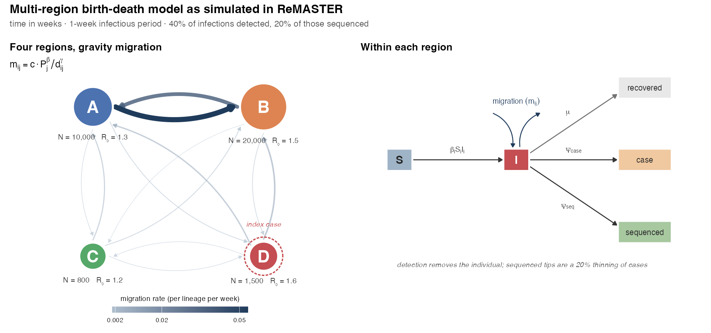

# Multi-region phylodynamic forecasting

Simulation machinery for nowcasting and forecasting a multi-region epidemic from
**case data and genomic data jointly**, built toward simulation-based neural
inference. The question driving it is whether adding a phylogeny improves
forecast skill over a tree-free baseline.



A 4-region SIR epidemic is simulated forward in
[ReMASTER](https://tgvaughan.github.io/remaster/) (BEAST 2.7); the observation
process — case reporting delays, the reporting triangle and its truncation, and
sequencing turnaround — is applied afterwards in R. The output is weekly case
data, a reporting triangle per region, and a time-scaled tree annotated with
sampling region, reduced to 104 summary statistics.

See **[SIMULATION.md](SIMULATION.md)** for the model, the observation process,
the statistics, and timings.

```bash
Rscript run-simulation.R
```

Needs R with `ape`, `castor`, `phangorn`, `treestats`, `ggplot2`, `dplyr`,
`tidyr`, `patchwork`, `glue`, `stringr`, and BEAST 2.7 with the ReMASTER
package installed.

## Status

Simulation suite works end to end (~5s per replicate), with migration under a
three-parameter gravity model (`c`, `beta`, `gamma`) over population sizes and
distances supplied as data. Not yet built: the parameter sweep, the ML
tree-estimation step, and the neural inference itself.

`figures/` and `output/` are committed for convenience and are fully
regenerable; BEAST run artefacts are gitignored and land in a local scratch
directory outside the synced project folder.
